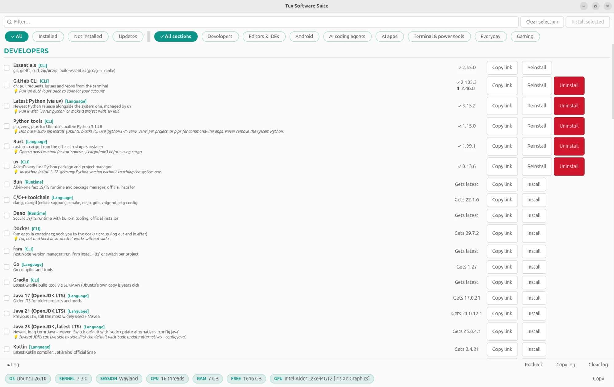

<div align="center">


# Tux Software Suite · TSS

**A Ninite-style app store for Ubuntu & Debian.**
Dev tools, AI coding agents, everyday apps and games — one click each, straight from the official source.




</div>

## ✨ Features

- **One-click install, reinstall and uninstall** for 60+ tools, with batch **Install selected** (apt packages are merged so you type your password once).
- **Open button** launches installed apps and IDEs, and opens AI agent CLIs in a terminal.
- **Transparent**: hover any name to see its official source and the exact command it will run. **Copy link** copies the source URL.
- **Live status**: installed versions, available updates, and filters by state or section.
- **Safe uninstalls**: apt removals do a dry run first and stop if they'd take anything else with them.
- **Collapsible log** with Copy and Clear, plus a system info bar (OS, kernel, session, CPU, RAM, disk, GPU).

## 📦 What's inside

| Section | Highlights |
| --- | --- |
| **Developers** | C/C++, Java 17/21/25, SDKMAN, Gradle, Kotlin, Python + uv, Rust, Node.js, fnm, TypeScript, pnpm, Bun, Deno, Go, Docker, GitHub CLI |
| **Editors & IDEs** | VS Code, IntelliJ IDEA, Zed, Neovim + LazyVim, Antigravity IDE, Trae, Qoder IDE |
| **Android** | Android Studio, adb/fastboot, scrcpy, Flutter |
| **AI coding agents** | Claude Code, Codex CLI, OpenCode, Devin, Qoder, MiniMax Code, Antigravity CLI, DeepSeek Harness, Verdent, Z Code |
| **AI apps** | Claude Desktop, T3 Code (release and nightly), Antigravity |
| **Terminal & power tools** | Ghostty, ripgrep/fzf/bat/eza/zoxide, Starship, lazygit |
| **Everyday** | Flatpak + Flathub, VLC, LibreOffice, GIMP, GNOME Tweaks, Timeshift, OBS Studio |
| **Gaming** | Steam, Lutris, Heroic, ProtonUp-Qt, GameMode + MangoHud, Discord |

Some tools (Antigravity app and IDE, Trae, Qoder IDE, OpenCode Desktop, Z Code) have no stable scripted Linux install, so their **Download** button opens the official download page instead.

## 🚀 Install

Download the latest `tux-software-suite_<version>_all.deb`, double-click it and click **Install** in App Center. Then open **Tux Software Suite** from the app menu.

Or from a terminal:

```bash
sudo apt install ./tux-software-suite_1.14.0_all.deb
```

Uninstall with `sudo apt remove tux-software-suite`. It replaces the old `dev-installer` package automatically.

Works on Ubuntu, Debian and derivatives (Mint, Pop!_OS…), since the buttons use `apt`.

## 🛠 Build from source

```bash
git clone https://github.com/Otterdays/Tux-Software-Suite.git
cd Tux-Software-Suite
./build-deb.sh          # package lands in dist/
python3 tux_software_suite.py   # or run it directly (needs python3-gi, gir1.2-gtk-4.0)
```

Bump `VERSION` in `build-deb.sh` for new releases.
